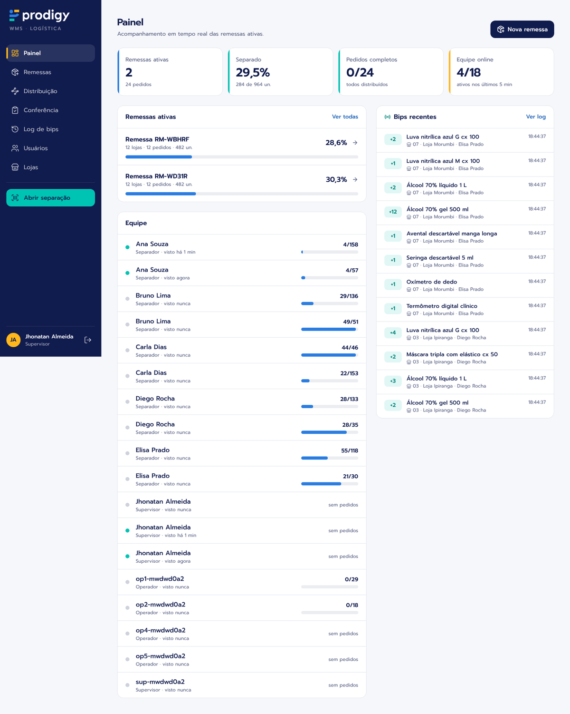
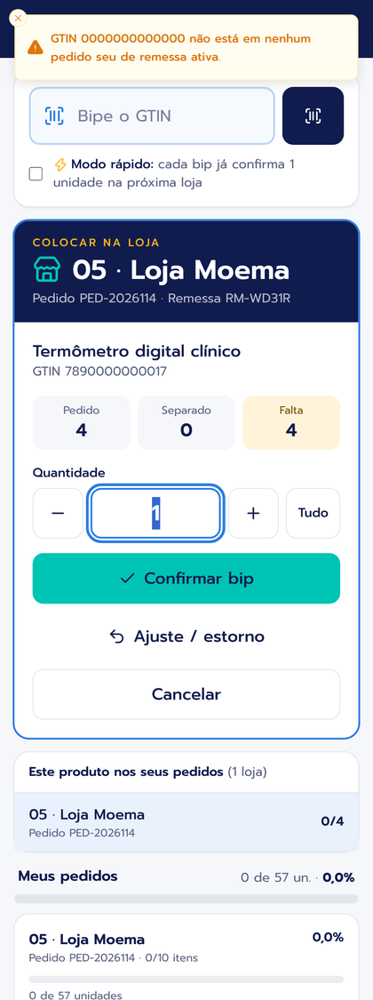

# Prodigy WMS

Separação de remessas por loja, com a identidade visual da Prodigy. Substitui o app
**Mini WMS** do Power Apps (solução `dp_Logistica`), sem Power Apps, Dataverse,
Power Automate nem SharePoint.

- **Front:** React + TypeScript + Tailwind (Vite). É um site estático que roda no navegador do PC ou do celular/coletor.
- **Banco, login e tempo real:** Supabase (Postgres). O plano gratuito atende bem uma equipe de 5 pessoas.

| Painel do supervisor | Separação (celular do operador) |
|---|---|
|  |  |

## O que tem

**Supervisor (PC)**
- **Painel:** mostra as remessas ativas, o % separado, os pedidos completos, quem está online e os bips em tempo real, atualizando sozinho.
- **Remessas:** importa o Excel (.xlsx) ou .csv com uma **prévia antes de gravar**. Linhas com problema e lojas novas aparecem na prévia. A remessa passa por **Pendente → Ativa → Concluída**, e dá para pausar, reabrir e excluir enquanto ninguém bipou.
- **Distribuição:** escolhe o operador de cada pedido, em lote ou pelo botão **Dividir automaticamente**, que equilibra as unidades entre a equipe.
- **Conferência:** divergências agrupadas por GTIN, com o detalhe loja a loja. Exporta CSV e permite concluir a remessa.
- **Log de bips:** filtros por GTIN, tipo, loja e operador, com exportação CSV.
- **Usuários:** cria, edita, redefine senha, desativa e reativa.
- **Lojas:** número de cada loja, que define a ordem da separação.

**Operador (celular ou coletor)**
- Bipa o GTIN e o app mostra **em qual loja colocar**, em letras grandes, com pedido, já separado e quanto falta. Confirma com Enter.
- **Modo rápido:** cada bip já confirma 1 unidade na próxima loja. Serve para leitor de código de barras.
- **Ajuste/estorno** para corrigir erros, com sons e vibração de confirmação e de erro.
- Lista "Meus pedidos" com o progresso de cada um.

## Do Power Apps para cá

| Power Apps / Power Automate | Aqui |
|---|---|
| `wms_tbCadastroUsuarios` (senha em texto puro) | Supabase Auth (senha com hash) + tabela `perfis` |
| `wms_tbRemessa`, `wms_tbPedidos`, `wms_tbItensPedido`, `wms_tbLojas` | `remessas`, `pedidos`, `itens_pedido`, `lojas` |
| `wms_tbColetor` | `bips` |
| `qtdSeparada` gravada no pedido (divergia dos itens) | sempre somada dos itens (`v_pedidos`, `v_remessas`) |
| Fluxos `wms_PreviewImportExcel` + `wms_ImportNovaRemessa` (linha a linha, SharePoint) | prévia no navegador + função `importar_remessa` (uma transação) |
| 3 `Patch` separados no "Confirmar Bip" | função `registrar_bip`: trava o item, confere o saldo no banco e grava o log junto |
| `LookUp(... Status = "Ativo")` (uma remessa só) | várias remessas ativas e o supervisor escolhe qual ver |
| Timer de `Refresh` | Supabase Realtime |
| E-mail fixo no fluxo | — (a importação é instantânea) |

As regras de validação continuam as mesmas: o bip não passa do pedido, o ajuste não deixa o
saldo negativo e o alvo é o primeiro pedido pendente pela ordem da loja. A diferença é que agora
elas valem também no banco, e não só na tela.

## Formato da planilha

Primeira aba, com cabeçalho. A ordem das colunas não importa, e também são aceitos alguns
nomes alternativos, como `Pedido`, `EAN`, `Descricao` e `Quantidade`.

| NomePedido | Loja | Gtin | Produto | Qtdped |
|---|---|---|---|---|
| PED-001 | Loja Centro | 7891234567890 | Produto exemplo | 12 |

Há um exemplo em `tests/fixtures/remessa-exemplo.xlsx` e o botão **Baixar modelo** na tela
Nova remessa. Formate a coluna GTIN como **texto** no Excel para não perder zeros à esquerda.

## Colocar no ar

### 1. Supabase

1. Crie um projeto em <https://supabase.com> (região São Paulo).
2. Aplique o banco:
   ```bash
   npx supabase login
   ```
   ```bash
   npx supabase link --project-ref SEU_PROJECT_REF
   ```
   ```bash
   npx supabase db push
   ```
   Outra opção: cole o conteúdo de `supabase/migrations/20261112190000_wms_inicial.sql` no **SQL Editor** e rode.
3. Publique a função de usuários:
   ```bash
   npx supabase functions deploy usuarios
   ```
4. Em **Authentication → Sign In / Providers**, desligue **Allow new users to sign up**. Só o supervisor cria usuários.
5. Crie o primeiro supervisor. A chave de serviço fica em **Project Settings → API Keys** e nunca deve ir para o front:
   ```bash
   SUPABASE_URL=https://SEU_PROJECT_REF.supabase.co SUPABASE_SERVICE_ROLE_KEY=chave-de-servico npm run criar-supervisor -- jhonatan "Jhonatan Almeida" uma-senha-forte
   ```

### 2. Site

1. Copie `.env.example` para `.env.local` e preencha `VITE_SUPABASE_URL` e `VITE_SUPABASE_ANON_KEY` (a chave anon/publishable).
2. Rode `npm install` e depois `npm run build`. A pasta `dist/` é o site.
3. Netlify: novo site a partir deste repositório, com **Build command** `npm run build`, **Publish directory** `dist` e as duas variáveis `VITE_...`. O arquivo `public/_redirects` já cuida das rotas.
4. Ou Render: **New → Blueprint**, escolha este repositório e confirme. O `render.yaml` cria um Static Site gratuito, que não dorme, já com as variáveis e as rotas configuradas.
5. Ou GitHub Pages (grátis, repositório público): em **Settings → Pages → Build and deployment → Source**, escolha **GitHub Actions**. A cada push na `main`, o workflow `.github/workflows/pages.yml` publica em `https://<usuario>.github.io/<repositorio>/`.

### 3. Uso diário

1. O supervisor cadastra a equipe em **Usuários** e o número das lojas em **Lojas**.
2. **Remessas → Nova remessa:** importa a planilha.
3. **Distribuir** e depois **Ativar**.
4. Os operadores entram pelo celular ou coletor e bipam.
5. **Conferência → Concluir remessa.**

## Desenvolvimento

Para subir tudo na máquina:

```bash
npm install
```
```bash
npx supabase start
```
```bash
npx supabase functions serve
```
```bash
npm run dev
```

O app abre em <http://localhost:5180> e, por padrão, usa o projeto Supabase de produção (`.env.development`). Para usar o Supabase local, crie um `.env.development.local` com a chave anon que o `supabase start` mostra e `VITE_SUPABASE_URL=http://127.0.0.1:54321` (ou `/sb`, que o Vite repassa ao Supabase local, para abrir de outro aparelho da rede).

Testes, com o Supabase local rodando e `SUPABASE_ANON_KEY`/`SUPABASE_SERVICE_ROLE_KEY` definidos:
```bash
npm run test:db
```
```bash
npm run test:e2e
```

- `test:db` cobre permissões, a importação e **5 operadores bipando ao mesmo tempo** sem perder bip nem passar do pedido.
- `test:e2e` cobre o fluxo inteiro no navegador: login, criação de 5 operadores, importação, distribuição, ativação, bip no celular, painel, conferência e log.
- `test:carga` simula uma remessa real (19 lojas, ~4.000 linhas, ~26 mil unidades) com 5 operadores bipando ao mesmo tempo. Resultado no Supabase local: importação em 0,2 s, busca do GTIN e bip em ~8 ms, painel e conferência em ~10 ms, 570 bips/s sem erro.

## Identidade visual

As cores, a fonte e o logo vêm do Manual de Marca Prodigy: azul-marinho `#111C4E`, azul `#2A7DE1`,
ciano `#00C4B3`, amarelo `#FFB71B` e a fonte **Prompt**. O logo é o vetor original extraído do
manual (`src/assets/logo-paths.json`, `public/logo-prodigy.svg`), e as curvas do login vêm do
"Sistema Gráfico" do manual.
