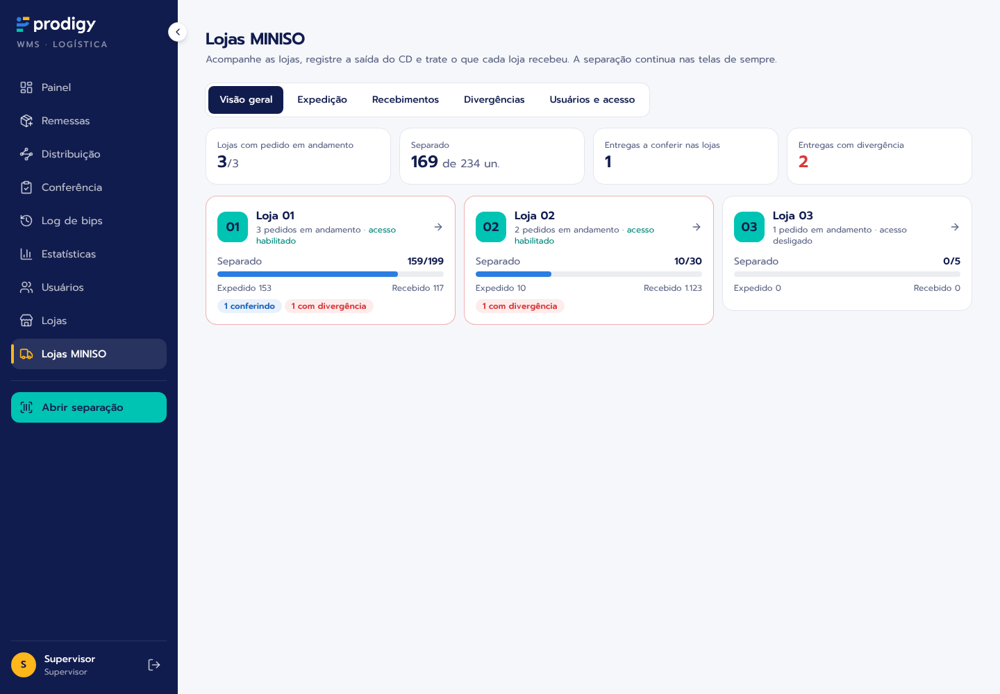

# Módulo das lojas: painel, expedição e conferência de recebimento

Implementação da especificação em [`README_MINISO_CLAUDE_CODE.md`](README_MINISO_CLAUDE_CODE.md).
Está na mesma aplicação e no mesmo banco do PRODIGY WMS e não muda nada para quem já usa.

| Painel da loja | Conferência no coletor | Lojas MINISO (PRODIGY) |
|---|---|---|
|  |  |  |

## Decisões

- **Continuam só dois perfis: `supervisor` e `operador`.** O administrador da loja é um
  **operador com loja vinculada** (`perfis.loja_id`). Ao entrar, ele vai direto para o painel da
  própria loja e não alcança as telas do CD.
- **O isolamento é feito no banco, e não só na tela.** `usuario_ativo()` passou a valer apenas para a
  equipe interna (perfil sem loja). Assim, todas as políticas e funções que já existiam recusam o
  usuário de loja. A leitura da própria loja vem de políticas novas, baseadas em
  `loja_do_usuario()`, que lê a loja do banco e nunca do navegador.
- **A habilitação é por loja** (`lojas.modulo_loja`). Enquanto o acesso estiver desligado, o usuário
  daquela loja não vê nada, mesmo logado.
- **Expedição:** o supervisor registra a saída do que foi separado e ainda não expedido. O manifesto
  (`expedicao_itens`) fica congelado. Um pedido pode ter várias entregas.
- **Recebimento:** a loja confere cada entrega contra o manifesto dela, não contra o pedido inteiro.
  Avaria é marcada na leitura e conta como recebida (físico = íntegro + avariado), mas gera uma
  ocorrência própria. Um GTIN que não estava no manifesto vira ocorrência "não esperado" e não entra
  no pedido.
- **Toda escrita passa por função transacional, com identificador de operação.** Reenviar a mesma
  operação não duplica nada; duas leituras reais do mesmo GTIN contam duas unidades. A bipagem e a
  finalização usam a mesma trava, então nada é gravado depois do fechamento.
- **Reabertura:** só o supervisor reabre, e precisa informar o motivo. A reabertura cria uma nova
  revisão; a contagem anterior e as divergências dela continuam no histórico. A resolução de uma
  divergência registra a solução sem alterar as quantidades.

## Equipe da loja

- **Administrador da loja** (`admin_loja = true`): cadastrado pela PRODIGY em **Lojas MINISO → Usuários e
  acesso**. Vê o painel e as entregas e cadastra, redefine a senha e desativa os **conferentes** da própria
  loja, em **Equipe da loja**.
- **Conferente da loja** (`admin_loja = false`): vê o painel e as entregas e confere. Não cadastra ninguém.
- A loja do novo usuário vem sempre do administrador logado, nunca da tela. O administrador não altera
  outros administradores nem a si mesmo, e não vê a equipe de outra loja (função `usuarios-loja` e
  `equipe_da_minha_loja()` no banco).

## O que muda no que já está em produção

A separação na PRODIGY (importar, distribuir, separar, conferir no CD, painel, log, estatísticas e
usuários da equipe) **continua igual**. Os arquivos dessas telas não foram alterados. No front, só
mudaram:

| Arquivo | Mudança |
|---|---|
| `src/components/Layout.tsx` | Item **Lojas MINISO** no fim do menu; `LayoutLoja` (mesmo visual, menu da loja); o `Protegido` manda o usuário de loja para `/loja` |
| `src/main.tsx` | Rotas novas (`/lojas-miniso…` e `/loja…`) |
| `src/lib/tipos.ts`, `src/lib/useConsulta.ts` | Tipos novos e tabelas novas no tempo real (só acréscimos) |

No banco, tudo é aditivo, com dois ajustes em objetos que já existem. Os dois foram testados e,
para a equipe atual, o resultado é o mesmo de antes:

- `usuario_ativo()` passa a valer só para quem **não** é de loja;
- a política de leitura de `perfis` esconde os usuários de loja da equipe interna. Assim, as telas
  Painel, Distribuição, Conferência e Usuários continuam mostrando só a equipe do CD, sem mudar uma
  linha delas.

A função `usuarios` (equipe do CD) não muda. Os usuários das lojas usam uma função nova,
`usuarios-loja`, que só mexe em usuário de loja.

## Fluxo

```
PRODIGY (como hoje)      importar → distribuir → separar → conferir no CD
PRODIGY (Lojas MINISO)   Expedição: registra a saída da loja (volumes); o que sai fica congelado
LOJA (login próprio)     painel da loja → Entregas → bipa o que chegou → Finalizar
PRODIGY (Lojas MINISO)   Recebimentos e Divergências: acompanha, reabre (com motivo) e resolve
```

A área **Lojas MINISO** tem as abas Visão geral (uma por loja), Expedição, Recebimentos,
Divergências e Usuários e acesso.

A conferência da loja (`src/pages/loja/ConferirRecebimento.tsx`) usa o mesmo layout, campo de
leitura, multiplicador, sons, vibração, cartão do último bip e lista de leituras da conferência do CD.
A única adição é o botão **Avaria**. O `Conferir.tsx` original **não foi alterado**.

## Ativação (homologação primeiro)

1. **Aplique a migração antes de publicar o front:**
   `supabase/migrations/20261117120000_modulo_lojas.sql`. Ela é aditiva; nenhuma loja fica
   habilitada e nenhum usuário fica vinculado.
2. Publique a função nova: `npx supabase functions deploy usuarios-loja`.
3. Publique o front (merge na branch usada pelo Render).
4. Em **Lojas MINISO → Usuários e acesso**, crie o administrador de cada loja (cada pessoa com o
   próprio login) e habilite as lojas piloto (2) e depois as demais.
5. Rotina: separação e conferência do CD como hoje → **Lojas MINISO → Expedição** → a loja confere
   em **Entregas** → a PRODIGY acompanha **Recebimentos** e **Divergências**.

Pedidos antigos, sem expedição registrada, não aparecem como entregas para conferir. O separado
nunca vira expedido de forma automática.

## Desligar o módulo (rollback funcional)

- **Uma loja:** desmarque o acesso dela em **Usuários e acesso**. O corte é imediato e nada é
  apagado.
- **Uma pessoa:** desative a pessoa na mesma aba. O banco não deixa tirar a loja de um usuário
  (ele viraria equipe interna).
- **Tudo:** desligue todas as lojas. Não desfaça a migração; o histórico fica preservado.

## Testes

```bash
npm run test:sql
```

Esse comando roda em um Postgres local descartável (`wms_teste`), sem Docker e sem tocar em nenhum
projeto Supabase. O arquivo `tests/sql/00_stub_supabase.sql` simula o mínimo do Supabase (papéis,
`auth.uid()`, publicação). O comando aplica **todas** as migrações e cobre:

- isolamento entre lojas (pedidos, itens, remessas, perfis, bips, expedições, confronto, funções);
- usuário de loja barrado na separação, na conferência do CD, na expedição, na importação, na
  distribuição e na escrita direta;
- os cenários de quantidade da especificação (falta 2; entrega parcial sem falta; avaria sem falta;
  sobra; GTIN inesperado);
- repetição de requisição (retry), estorno, finalização repetida, reabertura com motivo e
  histórico;
- usuário desativado e loja desligada perdendo o acesso com a sessão aberta;
- regressão: equipe interna e conferência do CD funcionando como antes, e as telas atuais sem os usuários de loja;
- concorrência: 5 aparelhos bipando com retry (sem perda e sem duplicação) e bipagem durante a
  finalização (nada é gravado depois do fechamento).

## Pendências reais

- `npm run test:db` e `npm run test:e2e` (os testes que já existiam) precisam do Supabase local
  com Docker e não foram rodados neste ambiente.
- O `.env.development` continua apontando para o projeto de produção, como antes. Para desenvolver
  e testar este módulo, crie um `.env.development.local` apontando para um Supabase local ou de
  homologação.
- Ficaram fora deste release: volumes identificados individualmente (QR por caixa), anexos/fotos de
  divergência, recebimento no CD e MFA. A especificação trata esses itens como evoluções.
- Latência em rede e coletores reais ainda não foi medida.
